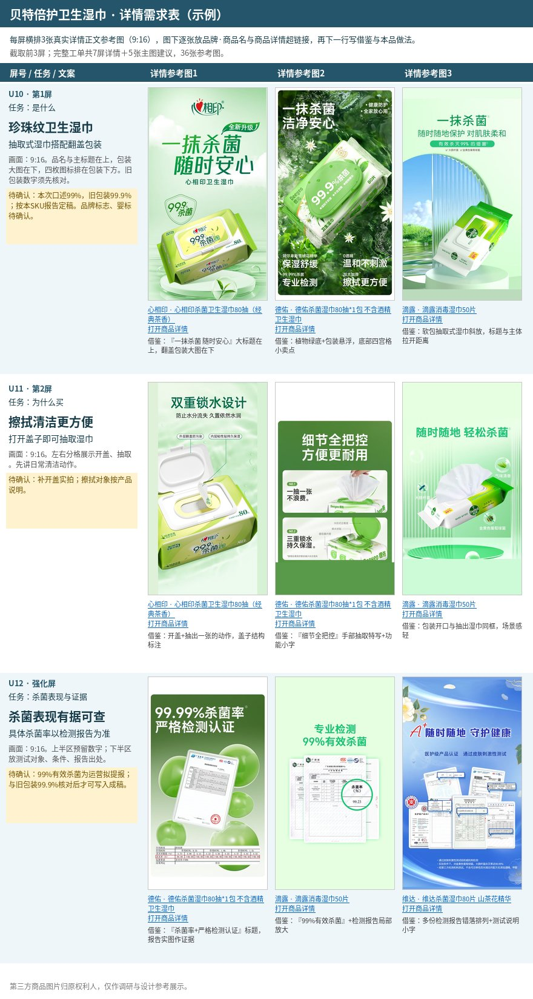
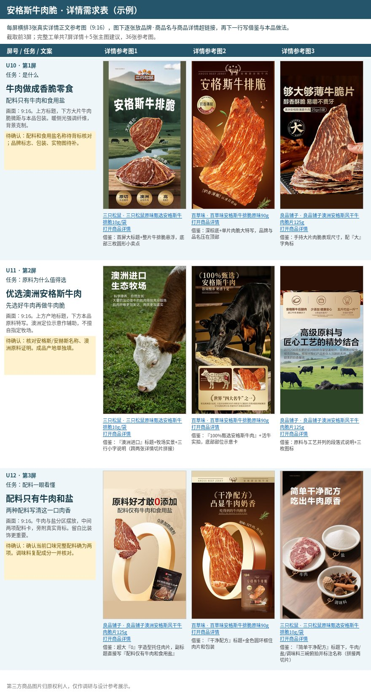
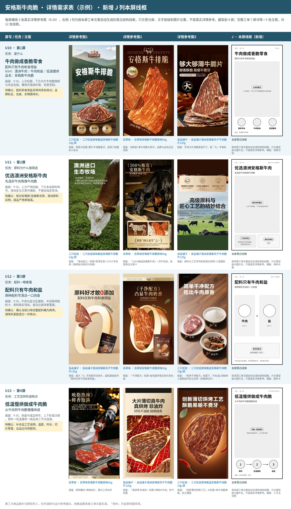

# 详情需求表

**给运营一个产品名称和几条卖点，让智能体调研真实竞品，整理成设计师能接手的 Excel 商详需求表。**

运营常常知道产品有什么特点，却要花时间逐屏想标题、找参考、贴图、查链接。设计师收到的表格也容易出现长文案、图片和卖点对不上、缺实物与证明资料等问题。

「详情需求表」将这段提报工作整理成可复用的 Agent Skill。它先查看指定品牌的真实商品详情，再把本品卖点写成逐屏内容，给每屏配三张参考图，并将待补资料集中交给运营确认。

## 可以生成什么

| 交付内容 | 具体要求 |
|---|---|
| 产品信息 | 保留原始卖点，记录已知人群、资料状态与待确认项 |
| 逐屏文案 | 主标题 6–12 字，副标题 8–16 字，icon 短句每条不超过 10 字 |
| 页面结构 | 首屏识别产品，之后讲购买理由、卖点、场景，产品信息收尾 |
| 画面执行 | 每屏 9:16，默认 900×1600 px，写明主体、构图、留白与证据位置 |
| 逐屏参考图 | 每屏横排 3 张，选取真实详情正文中的对应单屏 |
| 图下出处 | 每张图片正下方放品牌、商品名称与可点击的商品详情链接 |
| 参考说明 | 写清借鉴什么，以及本品具体怎么做 |
| 主图建议 | 默认附 5 张主图的内容方向，尺寸按销售渠道确定 |
| 运营待补 | 实物、包装、配料、检测、适龄等集中列出 |

默认输出一个 `.xlsx`，包含「详情需求表」「竞品调研」「运营待补」。正文参考图实际嵌入 Excel，下载后可以离线查看。点击图片下方链接可打开对应商品页。

缺少产品事实时可以先出审核草稿。高钙、杀菌率、适龄、配料等需要对应本品资料，待核对内容会明确标记。

## 复制链接安装

将下面这段话发给支持安装 Agent Skills 的智能体。

```text
请从这个公开 GitHub 仓库安装「详情需求表」Skill。
https://github.com/Banye0517/detail-requirements-skill
Skill 位于仓库根目录，入口为 SKILL.md，标识为 detail-requirements。
请按你所在平台的技能安装方式保留 references、assets 和 scripts。
安装后，我发送产品名称和卖点时，请按这个 Skill 完成竞品调研并生成 Excel 需求表。
```

支持 [Skills CLI](https://github.com/vercel-labs/skills) 的环境也可运行以下命令，并按提示选择智能体。CLI 当前要求 Node.js 22.20 或以上。

```sh
npx skills add https://github.com/Banye0517/detail-requirements-skill --skill detail-requirements
```

也可以 [下载 Skill 安装包](https://github.com/Banye0517/detail-requirements-skill/releases/latest/download/detail-requirements.zip)，完整解压后导入平台的技能管理器。手动安装说明见 [INSTALL.md](INSTALL.md)。

**完整运行需要宿主具备联网检索、查看和获取图片、写入 Excel、交付文件的能力。**通用 Skill 结构可供支持该格式的平台识别，平台的权限、联网环境和安装机制仍会影响实际运行。只支持自定义指令的平台，可加载本包指令和资源作为工作流。当前尚未对每个智能体逐一实机验收。

## 日常只发名称和卖点

```text
产品名称：轻酥太阳米饼，儿童零食。
卖点：黑土好米，米香清甜；芝香蛋浓，果蔬真味；
高钙配方；太阳花造型，好萌趣。
再加一个食用场景。
```

智能体执行产品整理、指定品牌检索、详情页拆解、逐屏策划、选图、填写 Excel 和导出检查。包装、报告和原表可以随单补充。关键人群未知时会集中确认，其余缺口写进运营待补表。

## 参考品牌规则

| 产品范围 | 必须覆盖检索的品牌 |
|---|---|
| 普通零食、儿童零食 | 三只松鼠、百草味、良品铺子 |
| 婴幼儿零食 | 英氏、宝宝馋了、奶酪博士、小鹿蓝蓝、秋田满满、爷爷的农场、禾泱泱、Babycare |

图片、文案和详情排版都在名单内选择。先找同类产品，再在名单内选择能解决同一设计问题的相邻品类。纸品、用品、洗护按实际品类选择参考。

参考图必须取自商品详情或商品描述正文。逐张检查画面焦点、文字层级、留白、清晰度和对应任务。优先有明确热销依据的商品，无法核实具体销量时如实记录。访问受限或图片不足会标明缺口。

## 前两个实际流程示例

以下示例按当前规范重新整理：每屏和每张主图建议各配 3 张 9:16 参考图，均取自真实商品详情正文，每张图正下方都有对应商品详情页的超链接，再下一行写借鉴什么、本品怎么做。两份工单各 12 行（7 屏详情＋5 张主图），共 36 张参考图、36 条链接。原图地址和裁切坐标记录在各图说明中。

### 示例一 · 卫生湿巾

输入包含产品名称「卫生湿巾」，以及「99%有效杀菌、未添加酒精、山茶花精华、3D珍珠纹」等卖点。

工单将卖点分到产品识别、购买理由、杀菌证据、配方、山茶花、巾面和产品信息屏。湿巾不套用零食名单，参考沿用早期示例涉及的德佑、滴露、维达、心相印四家，均取自京东自营商品「商品介绍」正文。用户口述 99% 与包装参考 99.9% 的差异保留为待核对项。

[下载卫生湿巾示例 Excel](examples/wipes/detail-request.xlsx)



### 示例二 · 安格斯牛肉脆

输入为「优选澳洲安格斯牛肉、只有牛肉和盐、低温慢烘工艺」，并要求 4 个食用场景。

工单依次安排产品识别、澳洲牛肉原料、两项配料、低温慢烘、成品质地、四场景及产品信息。场景提案为居家追剧、办公小歇、朋友分享、周末野餐，分别写明短文案和画面执行。参考只取三只松鼠、百草味、良品铺子三家的京东自营或官方店详情正文。

[下载安格斯牛肉脆示例 Excel](examples/angus-beef/detail-request.xlsx)



## 线框试看示例

`examples/angus-beef-wireframe/` 是上面这份安格斯牛肉脆正式工单的黑白线框试看。正式 Excel 仍是 [examples/angus-beef/detail-request.xlsx](examples/angus-beef/detail-request.xlsx)。Skill 的日常流程仍是调研后交付 Excel 需求表，线框不是必做步骤。

试看脚本只读取工单里已经写好的标题、副标题、标签和画面说明，按本屏任务套用固定版式，标出图片位置和「待补」。它按这一份已有工单试做，尚未在其他产品上验证，不能当作通用线框功能。

试看稿在三张参考图右侧增加 J 列「本屏线框」，并另附可单独打开的 HTML。36 张详情参考图和 36 条商品链接保持原样，另外嵌入 12 张线框。原文案、待补项和场景「提案」保持原样：第 6 屏仍是策划提案，第 7 屏产品信息除品名外仍为待补。普通零食参考品牌仍只有三只松鼠、百草味、良品铺子。

详情屏线框对应工单的 9:16（900×1600 px）。五张主图线框也按 900×1600 截出，只为和表格里的参考图列对齐。真实主图比例仍按销售渠道确认，本示例没有确认任何渠道尺寸。

[下载带线框的安格斯牛肉脆试看 Excel](examples/angus-beef-wireframe/detail-request-with-wireframe.xlsx)



[打开黑白线框 HTML](examples/angus-beef-wireframe/angus-wireframe.html)

## 文件结构

```text
SKILL.md                          智能体工作指令入口
INSTALL.md                        平台安装与运行能力说明
agents/openai.yaml                支持该字段的平台显示中文名称
assets/detail-request-template.xlsx  空白运营工单
references/order-fields.md         工单字段与原表映射
references/input-schema.md         导出器输入格式
scripts/build_workbook.py          三图、图下链接及Excel导出
examples/angus-beef/              正式示例：每屏三张详情参考图
examples/wipes/                   正式示例：每屏三张详情参考图
examples/angus-beef-wireframe/    安格斯牛肉脆线框试看，不覆盖正式工单
```

## Excel 导出器

智能体可以使用宿主表格工具，或调用附带 Python 导出器。脚本根据已完成的调研 JSON 排表、嵌图和创建超链接。图片先由智能体获取到本次工作目录。

```sh
python -m pip install -r requirements.txt
python scripts/build_workbook.py input.json output.xlsx
```

安装了 uv 的环境可以直接临时加载依赖。

```sh
uv run --with openpyxl --with pillow python scripts/build_workbook.py input.json output.xlsx
```

运行要求为 Python 3.10 或以上。数据格式见 [input-schema.md](references/input-schema.md)。导出器会检查每屏三张图、9:16比例、标题长度、来源字段及导出后的图片和超链接数量。未取得足够参考时可以显式生成带缺口的草稿，交付时需说明未完整。

## 验证情况

已验证 Skill 格式、三图 Excel 生成、图片下方逐图超链接、缺少第三张图片时的拒绝处理、空白模板、文件回读与压缩包完整性。已核对两份正式示例各 36 张参考图和 36 条商品链接，以及线框试看工单额外的 12 张 J 列线框。线框 HTML 自包含，主图线框的 9:16 只用于表格对齐。已进行导出后的渲染检查。商品页可访问性、参考图质量和产品事实仍由执行智能体逐单核对。线框试看尚未作为通用功能验收。

## 方法与素材来源

本项目将个人详情页策划、内容线框模式和运营工单规则整合为独立流程，感谢以下方法来源。

- [般叶 · 电商详情页策划](https://github.com/Banye0517/ecommerce-detail-page-skill)
- [saibodafu · ecommerce-content-wireframe](https://github.com/saibodafu/e-commerce-skill/tree/main/skills/ecommerce-content-wireframe)

原创指令与代码采用 [MIT License](LICENSE)。案例中的第三方商品图片、标志和引用材料归原权利人，未纳入本项目 MIT 授权。案例用于展示调研与设计参考过程，使用者需要自行确认实际素材使用权限。
